# CanvasPilot

## Architecture

CanvasPilot is a desktop application built on .NET and Avalonia. It is structured as one system. The
software items documented are twelve subsystems, `Annotation`, `AppShell`, `Chat`, `Composer`, `Knowledge`, `Logging`,
`Payload`, `Preview`, `Project`, `Settings`, `Speech`, and `Utilities`.

```mermaid
flowchart TD
    subgraph Annotation
        MarkRegistry
        MarkSourceResolver
        AnnotationOverlay
    end
    subgraph AppShell
        MainWindowShell
        ProjectWorkspace
        AboutDialog
    end
    subgraph Chat
        ChatPanel
        PayloadInspector
    end
    subgraph Composer
        ComposerDocument
        ComposerHistory
        AttachmentIntake
        AttachmentStore
        ComposerViewModel
        ComposerEditor
    end
    subgraph Knowledge
        KnowledgeCatalog
        KnowledgeSearch
        KnowledgePromptBuilder
        KnowledgeTools
        KnowledgeSkills
        KnowledgeMarkdown
        KnowledgeBrowser
    end
    subgraph Logging
        RollingFileLogger
    end
    subgraph Payload
        MessagePayload
        MarkImageComposer
        PayloadBuilder
        PayloadDescriber
    end
    subgraph Preview
        ImageRenderService
        PreviewPane
        ImageExporter
        ImageDragSource
    end
    subgraph Project
        ProjectService
        RecentProjects
        NewProjectDialog
        ProjectExplorer
    end
    subgraph Settings
        SettingsService
        SettingsDialog
        AiProviderSettingsPage
    end
    subgraph Speech
        AudioDeviceService
        SpeechModelService
        DictationService
        DeviceSelection
        ModelCatalogPanel
        ModelParameterEditor
        SpeechSettingsPage
    end
    subgraph Utilities
        PathHelpers
    end
    RollingFileLogger --> PathHelpers
    ComposerHistory --> ComposerDocument
    AttachmentIntake --> ComposerDocument
    AttachmentIntake --> AttachmentStore
    AttachmentIntake --> RollingFileLogger
    AttachmentStore --> PathHelpers
    AttachmentStore --> RollingFileLogger
    AttachmentStore --> ProjectService
    ComposerViewModel --> ComposerDocument
    ComposerViewModel --> ComposerHistory
    ComposerViewModel --> AttachmentIntake
    ComposerViewModel --> AttachmentStore
    ComposerViewModel --> MarkRegistry
    ComposerViewModel --> DictationService
    ComposerViewModel --> RollingFileLogger
    ComposerEditor --> ComposerViewModel
    ComposerEditor --> AttachmentIntake
    ChatPanel --> ComposerViewModel
    ChatPanel --> ComposerEditor
    ChatPanel --> MarkRegistry
    ChatPanel --> AnnotationOverlay
    ChatPanel --> MarkImageComposer
    ChatPanel --> MessagePayload
    ChatPanel --> DictationService
    ChatPanel --> PayloadInspector
    ChatPanel --> RollingFileLogger
    ChatPanel --> PathHelpers
    PayloadInspector --> PayloadDescriber
    PayloadInspector --> MessagePayload
    MainWindowShell --> PayloadInspector
    MainWindowShell --> ComposerViewModel
    MarkRegistry --> ImageRenderService
    AnnotationOverlay --> MarkRegistry
    AnnotationOverlay --> PreviewPane
    AnnotationOverlay --> RollingFileLogger
    MarkSourceResolver --> MarkRegistry
    MarkSourceResolver --> ImageRenderService
    MarkImageComposer --> ImageRenderService
    MarkImageComposer --> MarkRegistry
    PayloadBuilder --> ComposerDocument
    PayloadBuilder --> AttachmentStore
    PayloadBuilder --> MarkRegistry
    PayloadBuilder --> MarkSourceResolver
    PayloadBuilder --> MarkImageComposer
    PayloadBuilder --> MessagePayload
    PayloadBuilder --> ComposerViewModel
    PayloadBuilder --> ImageRenderService
    PayloadDescriber --> MessagePayload
    MessagePayload --> ComposerDocument
    MessagePayload --> MarkRegistry
    MessagePayload --> MarkSourceResolver
    MessagePayload --> ImageRenderService
    ImageRenderService --> RollingFileLogger
    PreviewPane --> ImageRenderService
    PreviewPane --> ProjectExplorer
    PreviewPane --> ProjectService
    PreviewPane --> ImageDragSource
    PreviewPane --> RollingFileLogger
    ImageExporter --> ImageRenderService
    ImageExporter --> RollingFileLogger
    ImageDragSource --> ImageRenderService
    ImageDragSource --> ImageExporter
    ImageDragSource --> PathHelpers
    ImageDragSource --> RollingFileLogger
    ProjectService --> PathHelpers
    ProjectService --> RollingFileLogger
    RecentProjects --> SettingsService
    NewProjectDialog --> ProjectService
    NewProjectDialog --> PathHelpers
    ProjectExplorer --> ProjectService
    ProjectExplorer --> PathHelpers
    ProjectExplorer --> RollingFileLogger
    SettingsService --> PathHelpers
    SettingsService --> RollingFileLogger
    SettingsDialog --> SettingsService
    AiProviderSettingsPage --> SettingsDialog
    AudioDeviceService --> RollingFileLogger
    SpeechModelService --> RollingFileLogger
    DictationService --> SettingsService
    DictationService --> SpeechModelService
    DictationService --> AudioDeviceService
    DictationService --> RollingFileLogger
    DeviceSelection --> AudioDeviceService
    ModelCatalogPanel --> SpeechModelService
    SpeechSettingsPage --> SettingsDialog
    SpeechSettingsPage --> DeviceSelection
    SpeechSettingsPage --> ModelCatalogPanel
    SpeechSettingsPage --> ModelParameterEditor
    MainWindowShell --> ProjectService
    MainWindowShell --> RecentProjects
    MainWindowShell --> NewProjectDialog
    MainWindowShell --> SettingsDialog
    MainWindowShell --> ProjectWorkspace
    MainWindowShell --> ImageExporter
    MainWindowShell --> AboutDialog
    MainWindowShell --> KnowledgeBrowser
    KnowledgeSearch --> KnowledgeCatalog
    KnowledgePromptBuilder --> KnowledgeCatalog
    KnowledgePromptBuilder --> KnowledgeSearch
    KnowledgeTools --> KnowledgeCatalog
    KnowledgeTools --> KnowledgeSearch
    KnowledgeTools --> KnowledgePromptBuilder
    KnowledgeSkills --> KnowledgeCatalog
    KnowledgeSkills --> KnowledgePromptBuilder
    KnowledgeBrowser --> KnowledgeCatalog
    KnowledgeBrowser --> KnowledgeSearch
    KnowledgeBrowser --> KnowledgeMarkdown
    KnowledgeBrowser --> RollingFileLogger
    ProjectWorkspace --> ProjectExplorer
    ProjectWorkspace --> ChatPanel
```

`PathHelpers` provides safe path combination and has no dependencies on other local items.
`RollingFileLogger` is the application's only log writer. It uses `PathHelpers` to resolve the active
log file and archive file paths inside its log folder, so that a malformed file name can never place a
log file outside that folder.

`SettingsService` owns the persisted settings and is the only item that reads or writes the settings file.
`SettingsDialog` hosts settings pages through a page contract and saves them through the service;
`AiProviderSettingsPage` is the page for the AI provider choices and implements that contract. The dialog
receives its pages from the application, so the `Settings` subsystem does not depend on the subsystems that
contribute pages. The AI provider choices are stored only; no agent or provider client is part of the
current build, and one added later reads the stored choices through the service.

`ProjectService` owns projects: a project is a folder holding a `{name}.canvaspilot` project file, a hidden
`.canvaspilot` folder for application data (the pictures that the user pastes into a message while it is a draft), and
the image source files, and, once a message with attachments is sent, an `attachments` folder. It is the only item that
writes project files. `RecentProjects` keeps the list of recently opened project files in the application settings
through `SettingsService`. `NewProjectDialog` collects and validates a project name and location, using
`ProjectService`, and `ProjectExplorer` lists, watches, selects, renames, and deletes the image source files in the root
of the open project's folder. The application supplies the folder picker, the image source filter, and the refresh
scheduler that these units use, so the `Project` subsystem does not depend on the main window.

`MainWindowShell` is the view model of the main window and the only item that talks to the user about projects and
settings: it runs the File, Edit, Image, Tools, and Help commands and shows its dialogs through an `IDialogService` that
the window implements. The Edit commands, Undo and Redo, act on the part of the window that has the focus (the
message editor), and the shell starts and stops the chat panel's dictation while the talk key (F8) is held.
`ProjectWorkspace` holds the project explorer, the preview pane, and, while a project is open, the chat column, and
`AboutDialog` identifies the application. At startup the application builds all units in one place,
`ApplicationComposition`, which system tests also use without a window.

`AudioDeviceService` is the only item that uses the audio system and `SpeechModelService` the only item that uses
the speech model catalog and its model store, both through the DemaConsulting.Speech library; each returns a machine
without audio hardware, an unreadable model store, and a failed download as a result with an explanation, never as an
exception. `DeviceSelection`, `ModelCatalogPanel`, and `ModelParameterEditor` are the view models and views of the
device pickers, the model lists with their downloads, and the tunable settings of a model, and `SpeechSettingsPage`
composes them into the "Speech" page of the settings dialog and maps them to and from the stored speech settings. The
application adds the page to the dialog after the AI Provider page, so the `Settings` subsystem does not depend on
speech.

`DictationService` turns speech into text for the message. While the user holds a talk control it listens through the
microphone and the speech-to-text model that were stored by the Speech page, shows the words recognized so far, and,
when the control is released, returns the final text, which the chat adds to the message as one dictated block. It is
the only item that holds a loaded speech engine and creates recognition sessions: `SpeechModelService` loads the engine
from the stored choices, `AudioDeviceService` creates the capture device of the chosen microphone, and the engine is
loaded once and reused. Every state in which dictation cannot work, such as no model chosen, a model that is not
downloaded, no microphone, an engine that will not start, or native speech files that are missing, is a result with its
own explanation, never an exception. The native speech runtime arrives with the speech library's packages and is
shipped beside the application and in the installer; `DictationService` checks that it is there before it loads an
engine, because an engine started without it can crash the process, which no code can catch. The talk button of the chat
panel calls the service, and so does the talk key, F8, through the main window.

`ImageRenderService` is the only item that draws files: it calls the CanvasNet viewer library in the background,
confined to the project folder, and returns the pixels, notes, or a coded error. Each picture it returns also says
exactly which picture it is (the file, a fingerprint of the file, and a fingerprint of the pixels) and where the
elements of a diagram, chart, or model were drawn, so that something said about the picture later can be tied to what
the user saw. `PreviewPane` also provides a layer over the shown picture, laid out in the picture's own pixel
coordinates and scaled with it, which other items fill with content that refers to places in the picture, and a slot in
its top bar, not scaled, for the controls of that content. `PreviewPane`
follows the selected file of `ProjectExplorer`, shows what `ImageRenderService` returns, discards results of renders
that are no longer wanted, and renders again when files in the project change. `ImageExporter` saves the shown picture
as a PNG file or copies it to the clipboard for the Image menu. `ImageDragSource` prepares the shown picture for
dragging it into another program, such as a presentation, a mail message, or a folder: it writes the picture as a PNG
file in a folder of its own, and the preview view offers that file and the picture's bitmap to the program the user
drops them on. The `Preview` subsystem owns the two interfaces that this needs, `IImageExporter` and `IExportDialogs`,
and does not refer to the main window.

`ComposerDocument` holds the message that the user is composing for the chat as an ordered sequence of typed text,
dictated text, and chips for attached files, folders, and images and for marks on the picture, and is the single source
of truth about the message. `ComposerHistory` applies each change that the user makes to the message as one undo step,
so that a typed character, a dictated block, a drop or paste of any number of items, an added mark, and a deleted chip
are each one step, and clears the steps, together with the message, when the message is sent. Neither of these units
depends on the user interface, on another subsystem, or on the file system. `AttachmentIntake` turns what the user drops
or pastes into the message, files, folders, pictures, and text, into chips and text, and treats all of it strictly as
data: it only looks at what a path is, never opens, runs, or copies it, and leaves out paths that are not safe to refer
to. `AttachmentStore` is the only item that creates files for attachments, and only inside the project: it saves pasted
pictures in the project's private data folder while the message is a draft, removes the ones that no chip refers to,
and, when the message is sent, copies the attachments from outside the project into the project's `attachments` folder,
all or none, within limits of 500 files and 200 MB for one message, with safe names that never replace another file,
without following links. `ComposerViewModel` is the orchestration of the message without a window: it owns the document,
the history, and the intake, receives what the editing control reports and turns each action of the user into exactly
one undo step, offers undo and redo to the Edit menu and the keys, shows the words that dictation recognizes while a
talk control is held and adds them as one dictated block when it is released, names what a drop left out, allows editing
only while a project is open, and sends the message: it has the attachments put into the project, has the message built
through `IMessageBuilder`, and then empties the draft, the history, and the marks and gives the immutable sent message
to whoever shows the transcript. `ComposerEditor` is the view of the message: one editing surface, the AvaloniaEdit
control, in which text, dictated text, and chips stand in order, each chip as one placeholder character that is drawn as
a small control; it shows what the view model holds and reports everything the user does to it, takes undo, redo,
paste, copy, cut, and drops over from the control and handles dropped and pasted content as data, and keeps the control
equal to the message after every change. The `Payload` subsystem uses the `Composer` subsystem to read the snapshot of
the message and the staged
attachments and to implement `IMessageBuilder`, which `Composer` owns; the `Composer` subsystem uses `Annotation` (the
registry of marks) and `Speech` (dictation) and, to send a message, the `Payload` subsystem only through that interface.

`MarkRegistry` holds the marks that the user draws on the shown picture to say what they mean in a message. Each mark is
pinned to the exact `RenderedImage` it was drawn on, numbered in the order the marks are made, and described by its
shape, its geometry in the pixels of that picture in one normal form, and an optional note of one short line. A mark is
part of the message exactly while its chip is in the composer's text, so the registry answers which marks belong to the
message and which are shown on a given picture; the marks of an earlier version of a file are not shown on the new
picture but stay in the message. `MarkSourceResolver` maps a mark to the parts of the source file that lie under it,
from the element positions and anchors that the renderer reported with the picture, and says that the picture cannot
tell, with the reason, when it reported none. Neither unit depends on the user interface or on the file system; the
`Annotation` subsystem depends only on the picture and coordinate types of `Preview` and on the logger.
`AnnotationOverlay` is the layer on which the user draws the marks: its tool bar offers a rectangle, an ellipse, a
freehand, and an arrow tool; the pointer or the keyboard draws the chosen shape in the pixels of the picture, in the
overlay slot of the preview pane, which is laid out in those pixels at any zoom; a finished shape asks for an optional
note, and then the overlay makes the mark in `MarkRegistry`, pinned to the picture that was shown when the shape was
started, and reports it. The overlay does not know the composer. The chat panel adds the chip of every reported
mark to the message with `ComposerViewModel.AddMark` and tells the overlay which mark chips the message holds, so the
overlay draws only the marks of the shown picture whose chips are in the message and says how many it hides. While a
tool is chosen the overlay has the preview pane turn off dragging the picture out, and Escape throws a shape away.

`MessagePayload` and the values it is made of are the one form in which the message that the user sends reaches the
assistant that is added later: the text with `[Mark n]` and `[Attachment n: name]` at the places of the marks and
attachments, the same message as parts in order that keep typed text apart from dictated text, the attachments with the
place where the user had them and their path in the project, and, for each picture that marks were drawn on, the picture
with the marks drawn and numbered on it, an image of the area around each mark, the geometry and note of each mark in
the pixels of the picture, and the parts of the source file under each mark. The values copy what they are given and
never change. `PayloadBuilder` makes the payload from a snapshot of the composer, the marks, and the attachments that
were put into the project, uses only the marks whose chips are in the message, and reads only values that cannot change,
so it can run in the background. `MarkImageComposer` draws the marks on the picture with CanvasNet, from an SVG document
that it builds in memory around the picture the user saw, and cuts the areas; it is the only item besides
`ImageRenderService` that uses CanvasNet to draw, and it never writes a file. `PayloadDescriber` writes a payload as
text for the user to read. Only the `Chat` subsystem and the composition root use the `Payload` subsystem, and no
subsystem uses the `Annotation` subsystem except `Payload`, `Composer`, `Chat`, and the composition root.

`ChatPanel` is the panel in which the user converses: above, the transcript of the messages that were sent in the open
project, oldest first; below, the composer's editing control; and between them and the user, a button that listens while
it is held and a button that sends. The transcript shows only sent messages, each once, with its words in the order they
were written (dictated words with the same subtle background as in the editing control), the chips of its attachments
and marks in their places with their pictures, and a button, "View payload". The panel keeps nothing on disk: the
transcript lives in memory and is dropped when the project changes or closes. Sending is the composer's own command, so
the panel only follows its state and shows the result: an entry for a message that was sent, and, when sending failed,
the composer's status text with the draft untouched. The talk button listens exactly as long as it is held: pressing the
pointer starts it and captures the pointer, and letting go anywhere, losing the capture, losing the focus, or removing
the panel ends it; when dictation cannot work, the composer's status line in the panel says why and what to do. The
panel also joins the annotation layer to the composer, which do not know each other: it adds the chip of every mark that
is drawn to the message at the caret as one undo step, and each time the message changes it tells the layer which mark
chips the message holds and whether marks can be made. It prepares dictation when it is shown and gives the chips their
pictures: the area around the mark, cut from the picture the mark was drawn on, and the preview of an attached picture
file. `PayloadInspector` is the window that "View payload" opens: it shows the text that `PayloadDescriber` writes for
the payload of the message, which is exactly what the assistant would receive, and, next to it, the pictures of the
payload: the annotated picture of every marked file and the area around every mark, each with a caption. The window
cannot change anything. The panel does not know what shows the inspector; it asks an `IPayloadInspectorLauncher`, which
`IDialogService` extends, so the main window shows it as a dialog. The `Chat` subsystem depends on `Composer`,
`Annotation`, `Payload`, `Speech`, and `Logging`, and not on `AppShell`. The main window places the panel in the chat
column of the workspace, which is shown while a project is open, and the shell makes the panel the target of the Edit
menu (through the composer) and of the talk key.

`KnowledgeCatalog` holds the knowledge of how to draw and how to work in a project as a tree of cards: the help of
CanvasNet, without the few cards that are only about the host program, extended with cards of CanvasPilot that are
embedded in the application and tell where files go in a project, how to make the picture the user uses, and how to read
the marks and attachments of a message. The catalog is built once, from embedded resources only, and never changes.
`KnowledgeSearch` finds the cards that fit some words, `KnowledgePromptBuilder` writes the index and the cards as text
for the prompt of an assistant within a size budget, `KnowledgeTools` describes the one tool by which an assistant
fetches them, and `KnowledgeSkills` describes each card as a skill; none of these units refers to a provider of a
language model, so the same knowledge can be given to any assistant that is added later, and until then only the user
reads it. `KnowledgeMarkdown` reads the Markdown of a card into blocks that a window can draw, without a Markdown
library, and `KnowledgeBrowser` is the window in which the user reads the cards: a tree, a search box that runs the same
search as the assistant, the card with its related cards and examples, and a button that copies an example. The window
is the only unit of the subsystem with a user interface. The browser does not know the main window; the shell asks an
`IKnowledgeBrowserLauncher`, which `IDialogService` extends, so the main window shows it beside itself, one at a time
and without blocking. The `Knowledge` subsystem depends on `Logging` (the log of a clipboard failure) and on CanvasNet,
and not on `AppShell`.

### Dependency Direction

The dependencies between the subsystems run one way: `AppShell` depends on `Preview`, and `Preview` does not depend on
`AppShell`. The seams belong to the provider, the lower subsystem. `Preview` owns `IImageExporter`, the contract the
Image menu uses, and `IExportDialogs`, the three platform operations that an export needs: choosing where to save,
putting a picture on the clipboard, and showing a message. `ImageExporter` asks the user only through `IExportDialogs`.
`AppShell` owns `IDialogService`, which extends `IExportDialogs` and adds the dialogs of the shell, so the main window
implements one interface and passes itself to the exporter. `MainWindowShell` holds the exporter as an `IImageExporter`,
using a disabled `NullImageExporter` when none is supplied, and `ApplicationComposition`, the composition root, builds
the render service, the preview pane, and the exporter, which is its job for every subsystem. `MainWindowView` turns the
`RenderedImage` of `Preview` into an Avalonia bitmap with `RenderedImageBitmap` when it puts it on the clipboard.
`ProjectWorkspace` still holds the preview as an untyped content object, found by the view locator.

Because the direction is fixed, a subsystem added later depends on the subsystems below it and never on `AppShell`; only
the composition root and the window refer to every subsystem. The `Chat` subsystem is the first of them: it uses
`Composer`, `Annotation`, `Payload`, and `Speech`, and the seam by which it asks for the inspector window,
`IPayloadInspectorLauncher`, belongs to `Chat`, so `IDialogService` extends it just as it extends the seams of `Project`
and `Preview`. The `Knowledge` subsystem follows the same rule: the seam by which the shell asks for the browser,
`IKnowledgeBrowserLauncher`, belongs to `Knowledge`, and `IDialogService` extends it too. The direction is shown in the
model and in the diagram above, and the verification of `ImageExporter`
uses a substitute for `IExportDialogs`, so no test of `Preview` needs the dialog service of `AppShell`, and the
verification of the chat panel and of the Help command uses a substitute for the launcher.

The same rule keeps `Composer` and `Payload` apart. The payload is built from the composer's snapshot, so `Payload`
depends on `Composer`; the composer sends the messages, so it needs them built. The seam belongs to the lower
subsystem: `Composer` owns `IMessageBuilder` and the `SentMessage` it returns, and `PayloadBuilder` implements the
interface, so `ComposerViewModel` never refers to the `Payload` subsystem. The composition root hands the payload
builder to the composer, and the sent message carries the payload as an object that only the `Payload` subsystem and the
code that shows it interpret.

### AI Provider Seam

The agent that will answer the messages and use an AI provider is out of scope of this version: message composition
exists without an agent. The user can compose, dictate, attach, mark, send, and inspect a message, and the sent message
is kept in the transcript, but nothing reads it and no answer comes back. The application holds no reference to any AI
provider library, the GitHub Copilot SDK, Ollama, or an agent framework. What exists is the stored choice: the
`AiProviderSettings` of the settings file (provider, model name, context window, reasoning level, Ollama endpoint,
Copilot command-line tool path, and the opt-in for unrestricted agent tools, which is off by default) and the
`AiProviderSettingsPage` that edits it. The input of the agent is `MessagePayload`, which is built for every sent
message and shown in the payload inspector. The seam for a later increment is `ISettingsService` for the choices and the
`SentMessage` that `ComposerViewModel` raises with `MessageSent` for the message: an agent that is added as a separate
subsystem reads the stored `AiProviderSettings` through the service and reacts to its `Changed` event, and no existing
unit has to change. The agent is to be built detached from the user interface: it receives its settings, the project
folder, and the message payload through its own interfaces, and answers through them, so that it can be tested without a
window and replaced by another provider. The model-name text box will then be replaced by a list that the provider
supplies, and the opt-in will decide whether the agent's tools are limited to the project folder. None of this exists
yet, no interface is declared for it, and no requirement depends on it.

## External Interfaces

**Log Files**: Local diagnostic output written by the application.

- *Direction*: Output.
- *Type*: Text files on the local file system.
- *Format*: One timestamped, leveled entry per line (exception details follow on additional lines),
  UTF-8, in `canvaspilot.log` plus timestamped archive files in the log folder.
- *Constraints*: The default location is `%LOCALAPPDATA%\CanvasPilot\logs`. Files are written locally
  only; no telemetry or remote transmission is performed. Disk usage is bounded by the rotation size
  and the retained archive count.

**Settings File**: The user's persisted settings.

- *Direction*: Input and output.
- *Type*: JSON file on the local file system.
- *Format*: One UTF-8 `settings.json` document with a `version`, the recent projects, the AI provider
  choices, and the speech choices. Unknown properties are ignored.
- *Constraints*: The default location is `%APPDATA%\CanvasPilot\settings.json`. The file is written
  atomically. A corrupt file is renamed `settings.json.bad` and defaults are used. The file never
  contains credentials.

**Settings Dialog**: The window in which the user edits settings.

- *Direction*: Input and output.
- *Type*: Avalonia modal window.
- *Format*: A page list with OK, Cancel, and Apply buttons.
- *Constraints*: Changes take effect only on OK or Apply, and invalid entries cannot be applied.

**Project Folder and Project File**: The user's projects.

- *Direction*: Input and output.
- *Type*: A folder on the local file system holding a `{name}.canvaspilot` JSON file, a hidden `.canvaspilot`
  folder, and the image source files.
- *Format*: The project file holds `formatVersion` (1), `name`, `createdUtc`, and an optional `modifiedUtc`;
  unknown properties are ignored when reading and kept when saving.
- *Constraints*: A project is created only in a new or empty folder. A project file with a newer
  `formatVersion` is refused with a message. Project and file names follow rules that hold on every supported
  platform.

**New Project Dialog and Project Explorer**: The windows and controls in which the user creates a project and
works with its files.

- *Direction*: Input and output.
- *Type*: Avalonia modal window and list control.
- *Format*: A name and location entry with OK and Cancel; a list of the image source file names of the open
  project.
- *Constraints*: OK is enabled only for a project that can be created. The list shows only image source files in
  the project root and follows file changes.

**Image Preview and Export**: The picture of the selected file, and the files and clipboard it is exported to.

- *Direction*: Input (the selected image source file and the files it uses) and output (the picture, a PNG file,
  and a clipboard image).
- *Type*: Avalonia control in the main window, files on the local file system, and the system clipboard.
- *Format*: The picture is drawn by CanvasNet at the file's natural size. An export is a PNG file with the same
  pixels, including transparency; a copy is a bitmap on the clipboard.
- *Constraints*: The drawn file may read other files only from inside the project folder. A file that cannot be
  drawn is explained with its error code, message, and hint, never an unhandled failure. Export and copy are
  enabled only while a picture is shown.

**Picture Drag-out**: The shown picture, dragged out of the preview into another program.

- *Direction*: Output.
- *Type*: The operating system's drag and drop, started from the preview in the main window, and PNG files in a
  folder named `drag` in the application's folder of the per-user local application data folder.
- *Format*: One drag carries one item that offers two formats: a file (a PNG named after the source file and the
  first eight characters of the picture's pixel fingerprint, for example `flow-1a2b3c4d.png`) and a bitmap of the
  same picture. The allowed effect is copy.
- *Constraints*: A drag starts only with the left button, after the pointer has moved four pixels, while a picture is
  shown and dragging out is not turned off. The application writes only files of that name pattern in its folder,
  deletes the files of earlier runs when it starts and its own files when it ends, and never changes the file
  the user dropped. A drop target that refuses the picture, or a file that cannot be written, is logged and never an
  unhandled failure. Whether a particular program accepts the file, the bitmap, or both is checked by hand (see the
  verification of `ImageDragSource`).

**Dropped and Pasted Content and Attachments**: What the user drops or pastes into the message, and the copies that are
made in the project when the message is sent.

- *Direction*: Input from the operating system's drag and drop and clipboard; output to files in the project folder.
- *Type*: Paths of files and folders, PNG bytes of pictures, and plain text, read by the view and handed over as one
  `DroppedContent`; files in the project's `attachments` folder and in `.canvaspilot/attachments`.
- *Format*: A dropped path becomes a chip that refers to it. A pasted picture is saved as
  `paste-{yyyyMMdd-HHmmss}-{n}.png` in `.canvaspilot/attachments` while the message is a draft. When the message is sent
  a file or folder from outside the project is copied to `attachments/{name}`, with `{name} (2)` and so on when a name
  is taken, a pasted picture is moved there, and a thing that is in the project already is referred to by its
  project-relative path with forward slashes.
- *Constraints*: Everything dropped is data, never opened or run. Paths that are not complete, that have `..`, device
  names, alternate data streams, or the device namespace are left out with a reason. One drop accepts at most 200 items,
  and one message copies at most 500 files, 500 folders, and 200 MB; a pasted picture is at most 50 MB. Nothing is
  copied while the message is a draft, nothing is overwritten, links are not followed, and a failed copy leaves nothing
  behind. The project explorer lists only image source files in the project root, so neither folder is listed.

**Drawing Knowledge**: The cards that tell how to draw with the formats CanvasNet draws and how to work in a project.

- *Direction*: Input (the cards that are embedded in the application and in the CanvasNet library) and output (the
  window in which the user reads them, and text copied to the clipboard).
- *Type*: Embedded Markdown resources, read once into an in-memory tree; an Avalonia window opened by Help > Drawing
  Knowledge; the system clipboard.
- *Format*: Each card has an identifier that is its path in the tree, a title, a one-line summary, tags, other names, a
  Markdown body, related cards, and examples with their text. The assistant of a later increment is given the same
  cards as an index, as cards on demand through one tool, or as skills.
- *Constraints*: Nothing is written to a file or sent anywhere. The few cards that are only about the host program
  are left out. A card that cannot be read, or a clipboard that cannot be reached, is a message, never an
  unhandled failure.

**Speech Settings, Audio Devices, and Model Store**: The speech choices, the audio system, and the downloaded models.

- *Direction*: Input and output.
- *Type*: The speech section of the settings file; the operating system's audio system, through the
  DemaConsulting.Speech library; the library's default model store on the local file system; and HTTPS downloads of
  model files.
- *Format*: Devices are stored by name, models by identifier, and each model's parameter values as
  invariant-culture strings, in the `speech` section of `settings.json`. The model store is
  `%LOCALAPPDATA%\DemaConsulting.Speech\Models` on Windows and is shared with other DEMA Consulting applications.
- *Constraints*: The audio system and the model store are used only when the Speech page is opened or dictation is used.
  Downloads start only when the user asks, verify checksums before installing, and are cancelled when the settings
  dialog closes. A machine without audio hardware, a blocked network, or an unreadable store is explained on the page
  and never causes a failure.

**Microphone and Speech Engine**: What dictation listens through and recognizes with.

- *Direction*: Input.
- *Type*: The operating system's audio input, through the audio library of the DemaConsulting.Speech library, and the
  native speech inference runtime and Sherpa interface that arrive with the library's packages.
- *Format*: Mono audio at the sample rate of the speech model, converted by the audio system from the format of the
  hardware; the output is text.
- *Constraints*: The microphone is open only while the talk control is held and a short moment after it is released, and
  is released when the session ends. The audio is never stored, and neither is the recognized text, except in the
  message that the user is composing; the application log holds events but never words. The native runtime files must be
  beside the application, and the speech engine is not loaded unless they are. Windows can block desktop applications
  from using the microphone; dictation then says so.

**Windows Installer Package**: The way the application is delivered.

- *Direction*: Output (built by the release pipeline) and input (to the user's Windows Installer).
- *Type*: One per-machine, 64-bit MSI file named `CanvasPilot-{version}-win-x64.msi`, built by the WiX Toolset from the
  installer project, which is not part of the solution.
- *Format*: The package carries the self-contained single-file `CanvasPilot.exe` publish output, the native libraries
  that stay beside it (the Skia, text shaping, and ANGLE graphics libraries and the speech inference runtime, Sherpa
  interface, and audio library), a Start Menu shortcut, and the Add/Remove Programs icon and links; its version is the
  numeric part of the build version.
- *Constraints*: Installing a package replaces any installed version, older or newer, and asks a running
  `CanvasPilot.exe` to close first. The package contains no user data, and uninstalling leaves the user's settings,
  logs, and projects in place.

**Main Window**: The application's window and menus.

- *Direction*: Input and output.
- *Type*: Avalonia window with File, Edit, Image, Tools, and Help menus, a project explorer, a preview area with a
  layer for marks, a chat column with the message composer and the transcript, and modal dialogs (New Project,
  Settings, About, payload inspector, and message, confirmation, and prompt dialogs) and, from the Help menu, the
  window of the drawing knowledge, which does not block the main window.
- *Format*: The window title is `{project name} - CanvasPilot` while a project is open, otherwise `CanvasPilot`.
  Every menu item has a name and an automation identifier that are the same. The F8 key is the talk key: dictation
  listens while it is held.
- *Constraints*: Menu items are enabled only when their command can run; Undo and Redo act on the part of the window
  that has the focus and are disabled when that part has nothing to undo. The chat column is shown only while a project
  is open. Problems are shown in a dialog, never as an unhandled failure.

## Dependencies

The `Annotation`, `AppShell`, `Chat`, `Composer`, `Knowledge`, `Logging`, `Payload`, `Preview`, `Project`, `Settings`,
`Speech`, and `Utilities` subsystems use .NET base class library types, `System.Text.Json` for the settings and project
files and the description of a payload, and, for dialogs, pages, and lists, Avalonia and CommunityToolkit.Mvvm, which
are runtime third-party items (the `Composer` editor view also uses the AvaloniaEdit editing control, which is a runtime
third-party item too; the other `Annotation`, `Chat`, and `Composer` units use base class library types and Avalonia
only, and the `Payload` units base class library types and CanvasNet; of the `Knowledge` units only the browser uses
Avalonia and CommunityToolkit.Mvvm, and the catalog reads the help cards of CanvasNet). The `ImageRenderService` unit
draws files and encodes PNG with the `DemaConsulting.CanvasNet.Viewer` library, the `MarkImageComposer` unit draws the
marks of a message over a picture with the same library, and the `ProjectExplorer` unit uses its extension list to
decide which files are image sources. The `AudioDeviceService`, `SpeechModelService`, and `DictationService` units list
audio devices and speech models, download models, create capture devices, and load and run the speech engine with the
`DemaConsulting.Speech` library and its Sherpa model package, whose native speech runtime is shipped with the
application, and the speech descriptor types are shown by the other units of the `Speech` subsystem; both libraries are
documented as OTS items (see *OTS Dependencies*). Build, documentation, and quality tools are documented in the OTS
design documents. The Windows installer package is built from the published application by the WiX Toolset, also
documented as an OTS item; no run-time item depends on it.

## Risk Control Measures

**Path confinement**: Every file path built from a caller-supplied name passes through
`PathHelpers.SafePathCombine`, which rejects traversal sequences and absolute paths. `RollingFileLogger`
applies this to its configurable base file name, so logging cannot create or overwrite files outside the
log folder. `SettingsService` applies it to the settings and temporary file names, and `ProjectService`
and `ProjectExplorer` apply it to project folders, project files, and renamed files. Segregation of the
checking logic into the `Utilities` subsystem lets it be reviewed and verified once for every consumer.

**Bounded diagnostics**: Log rotation caps the disk space consumed by diagnostic output, so a failure
that logs repeatedly cannot exhaust the user's disk.

**Safe settings handling**: A save writes a temporary file and then replaces the settings file, so a failure
cannot leave a truncated file. A corrupt or newer file is tolerated with defaults and a log entry, so a
damaged file cannot prevent startup. Values are validated when read and when entered, so an out-of-range
value cannot reach the rest of the application.

**Safe agent defaults**: The opt-in for unrestricted agent tools is stored as off by default and changes
only when the user explicitly checks it in the dialog.

**Safe project handling**: A project is never created in a folder that already has content, and a failed or
cancelled creation removes what it added. Project files are saved by writing a temporary file and replacing
the project file, and a file from a newer version is refused rather than rewritten, so it cannot be
damaged. Renaming a file never replaces an existing file or folder, and deleting is left to the caller to
confirm with the user. Names are checked against rules that reject separators, traversal, hidden names, and
reserved device names.

**Confined drawing**: The files that a drawn file references (embedded pictures, model includes, chart data) are read
only from inside the project folder, through CanvasNet's `UnderRoots` file access policy, so an image source file
cannot pull unrelated files of the user's computer into a picture that is exported or shared. A denied file is
reported as a note. Drawing runs in the background and can be cancelled, so a slow or hostile file cannot block the
window.

**Dropped content is data**: Files, folders, pictures, and text that the user drops or pastes may come from the internet
or from mail and may be programs, scripts, or names built to reach devices, other drives, or other files.
`AttachmentIntake` only asks the file system what a path is and how large a file is, which does not open it, so a
program or script becomes a chip like any other file and nothing is run, rendered, or followed; it leaves out, with a
reason, every path that is not a complete path or that has a `.` or `..` part, a device name, an alternate data stream,
a trailing dot or space, or the device namespace, and a whole drive. Pasted pictures are saved only after the PNG
signature and a limit of 50 MB are checked, and are never decoded. Nothing is copied while the message is a draft.

**Confined attachment copies**: When the message is sent, `AttachmentStore` is the only item that creates files for
attachments, and it creates them only in the project's `attachments` folder and in `.canvaspilot/attachments`. Every
path is built with `PathHelpers.SafePathCombine` from names that were made safe (characters a name cannot hold replaced,
device names changed, trailing dots and spaces removed, length limited), files are created exclusively and never replace
another file, symbolic links and junctions in a dropped folder are not followed, a folder that holds the project is
refused so that it cannot be copied into itself, the project's private data folder cannot be attached except for the
pictures the store saved, and the copy is bounded by 500 files, 500 folders, and 200 MB for one message, checked before
the copy and again during it. A failed copy removes everything it created. The originals are never changed or deleted.

**Bounded drag files**: The files written for dragging a picture out are named from the source file's name with
characters that a file name cannot hold replaced and the length limited, and are built with
`PathHelpers.SafePathCombine`, so a file name cannot lead outside the drag folder. The unit deletes only files that
match its own name pattern, never folders or other files, so cleaning up cannot remove the user's files.

**Clean message text**: Text that enters the message being composed, whether typed, pasted, dropped, or recognized from
speech, is data from outside the application. `ComposerDocument` removes from it the character that stands for a chip
and every control character other than tab and line feed, so that text can never be taken for a chip or confuse the
editing control or the tools that read the message. The draft and its undo steps are kept in memory only, are never
written to disk, and are cleared when the message is sent.

**Safe speech handling**: Downloads of speech models start only when the user asks, run over HTTPS, and are verified
against checksums by the speech library before a model is installed completely or not at all, so a damaged or
tampered download is discarded. A download never outlives the settings dialog that shows it. A choice that the page
cannot show, such as a device that is not connected or a model while the model store cannot be read, is kept in the
settings instead of being erased, and failures of the audio system and the model store are results, never
unhandled exceptions.

**Safe speech runtime**: Starting the speech engine without its native runtime beside the application does not fail
cleanly: Windows then loads an older inference runtime from its system folder and the process crashes inside the native
library, which cannot be caught and would lose the message that the user has not sent. `DictationService` is therefore
the only item that loads an engine, it checks that the runtime files exist before it does, and it reports that the
speech runtime is missing instead when they do not. The files are in the published output, which the installer harvests,
and the build verifies both the published output and the file table of the installer package. Dictation also listens
only while the talk control is held, releases the microphone when it ends, keeps neither audio nor recognized text
outside the message, and writes events but never words to the log.

Application subsystems call `RollingFileLogger.Log` with a severity, a message, and optional exception
context. `RollingFileLogger` asks `PathHelpers` to resolve the active file path inside the log folder,
rotates and prunes archives when the active file has reached its size threshold, and appends the
formatted entry to the active file. Nothing flows back to the caller except a propagated `IOException`
when an entry cannot be written.

At startup the application loads the settings through `SettingsService`, which reads and normalizes
`settings.json`. To change settings, the application shows `SettingsDialog` with the pages to host. Each
page loads its working state from the settings in effect; on OK or Apply the dialog merges every page into the
latest settings and calls `SettingsService.Save`, which writes the file atomically and raises `Changed`.

To create a project, the application shows `NewProjectDialog`, which validates the entries through
`ProjectService`; when the dialog was accepted, the application calls `ProjectService.CreateAsync`, which
creates the project folder, the project file, and the data folder. To open a project, the application calls
`ProjectService.OpenAsync`. Either way, the project file is added to `RecentProjects`, which stores the list
through `SettingsService`, and the project folder is opened in `ProjectExplorer`, which lists its image source
files, watches the folder, and refreshes the list after file changes.

At startup `App` asks `ApplicationComposition` to build the units: the logger, the settings service (whose settings are
loaded at once), the project service, the recent projects list, the project explorer, the render service, the image drag
source (which deletes the files of earlier drags), the preview pane, the workspace, the image exporter, the speech
services with the dictation service, the shell, the mark registry, the mark image composer and payload builder, the
composer (with its attachment store and intake), the annotation overlay, and the chat panel, which it places in the
workspace and makes the target of the talk key. It also gives the shell a function that gives the catalog of the drawing
knowledge, which reads the cards the first time Help > Drawing Knowledge is used and not at startup. The
`MainWindowView` is created over the shell and gives itself to the shell as the dialog service. From then on the user's
menu choices become shell commands, which call the `Project` and `Settings` subsystems, show dialogs through the dialog
service, and, when the open project changes, update the window title and open or close the project in the workspace. On
exit `App` disposes the composition.

When the user selects a file in `ProjectExplorer`, `PreviewPane` cancels any render that is running and asks
`ImageRenderService` to draw the file in the background; the result, a picture with notes or an error with its
code and hint, is shown unless a newer render was started meanwhile. When files in the project change, the pane
renders again after a short delay. The Image menu runs `ImageExporter`, which encodes the shown picture as PNG and
writes it where the user chooses, or hands it to the window to put on the clipboard. When the user presses the left
button on the shown picture and moves the pointer, the preview view asks `PreviewPane` for the picture as a file;
`ImageDragSource` writes the PNG in its folder, and the view starts the operating system's drag with that file and
a bitmap of the picture.

The message being composed is held by `ComposerDocument`, and every change the user makes to it, typing, dictating,
dropping, pasting, adding a mark, and deleting, is made as one `ComposerEdit` that `ComposerHistory.Execute` applies to
the document and records. Undo and redo revert and apply whole edits and return the caret to restore. The editing
control does not make edits itself: it reports what the user did to `ComposerViewModel`, whose methods
(`ApplyTextChange`, `AddDictatedBlock`, `HandleDrop`, `HandlePaste`, `AddMark`, `DeleteChip`) each make exactly one edit
and tell the control once that the message changed. When the message is sent, the history hands over a snapshot of the
document, from which the message is built, and empties the document and the history.

When the user draws a mark on the shown picture, the layer over the picture gives `MarkRegistry.Add` the picture, the
shape, and the points of the pointer in the picture's pixels, once the shape is finished and its optional note is
entered or skipped. The registry puts the points in normal form inside the picture, numbers the mark, and returns it;
the overlay reports the mark, and the chat panel adds its chip to the message as one `ComposerEdit.AddMark`, so
that undoing it removes the chip and hides the mark. Each time the composer changes, the panel tells the overlay which
mark chips the message holds, and the overlay asks `MarkRegistry.VisibleMarks` with those identities and the key of the
picture to show a picture. To describe a mark to the assistant, `MarkSourceResolver.Resolve` reads the element positions
or anchors of the mark's picture and returns the parts of the source file under the mark, or that the picture cannot
tell.

When the message is sent, `ComposerViewModel.SendAsync` takes a snapshot of the document, puts the attachment chips of
the snapshot into the project with `AttachmentStore.StageForSend` on a thread-pool thread, and gives the snapshot, the
marks whose chips are in it, and the staged attachments to `IMessageBuilder.BuildAsync`, which `PayloadBuilder`
implements. While this goes on the draft cannot be changed. Only when both steps worked does it empty the draft with
`ComposerHistory.CompleteSend`, forget the marks with `MarkRegistry.Clear`, remove the saved pictures that no chip
refers to, and raise `MessageSent` with the immutable `SentMessage`; when a step fails, the draft, the history, and the
marks are left as they were and the status text says why. The builder walks the snapshot once, writing the text with
its references and the parts of the message in order, and keeps the marks whose chips are in it. It groups those marks
by picture, has `MarkImageComposer` draw the marks of each picture and cut the area around each mark, asks
`MarkSourceResolver` for the parts of the source under each mark, and returns a `MessagePayload` that nothing can
change. `PayloadDescriber.Describe` writes the payload as text for the user.

When the user drops files or folders on the message, or pastes a picture or text into it, the view reads the drop or the
clipboard into a `DroppedContent` and gives it to `AttachmentIntake.Accept`. The intake checks the text of each path,
asks the file system whether it is a file or a folder, saves pasted pictures through `AttachmentStore.SavePastedImage`,
and returns chips and text, with notes for what it left out; `ComposerViewModel.HandleDrop` or `HandlePaste` inserts
them as one `ComposerEdit.Drop` and names what was left out in its status text. Nothing is copied. When the message is
sent, the chips of the snapshot are given to `AttachmentStore.StageForSend`, which plans the copies against the limits,
copies the attachments from outside the project into the project's `attachments` folder, moves pasted pictures there,
and returns for each chip its path in the project, or the chip that prevents the message from being sent and why. After
sending, when a project is closed, and when a project is opened, `RemoveLeftovers` deletes the pasted pictures that no
chip refers to. When the user opens Settings and chooses the Speech page, `SpeechSettingsPage` loads: `DeviceSelection`
asks `AudioDeviceService` for the devices and selects the stored ones by name, `ModelCatalogPanel` asks
`SpeechModelService` for the models and selects the stored ones by identifier, and `ModelParameterEditor` shows the
parameters of the chosen models with their stored values. A download requested in the panel goes through
`SpeechModelService` to the speech library, which reports progress to the row and ends as installed, canceled, or
failed. On OK or Apply the page merges the choices into the speech section of the settings, which `SettingsService.Save`
writes. When the dialog closes the page cancels downloads that are still running.

When the user holds a talk control, the caller asks `ComposerViewModel.BeginPushToTalkAsync` to begin, which asks
`DictationService.BeginAsync`; the composer shows why when there is no session, and the words as they are recognized
when there is, moving them to the thread of the caller. The service reads the speech settings, asks
`SpeechModelService.Enumerate` whether the chosen speech-to-text model is installed, checks the native speech files,
and, the first time, has `SpeechModelService.LoadRecognizerAsync` load the engine with the stored parameter values
converted to their types, and keeps it. It asks `AudioDeviceService.CreateCaptureDevice` for the chosen microphone,
creates a recognition session over the engine and the device, starts reading its results, and starts the session. Each
provisional result replaces the sentence being recognized and each final result ends it, and the words so far are
available as `PartialText`. When the user lets go the caller ends the session through
`ComposerViewModel.EndPushToTalkAsync`: it keeps listening for a short moment, stops the recognition, which finishes the
audio already received, releases the session and the microphone, and returns the final text, which
`ComposerEdit.Dictate` adds to the message at the caret as one dictated block. If dictation cannot start, the same call
returns the reason and the message, and nothing is loaded that could crash the process.

In the chat panel the talk button does this with the pointer: `ChatPanelView` starts `BeginPushToTalkAsync` when the
pointer is pressed on the button and captures the pointer, and ends it with `EndPushToTalkAsync` when the pointer is
released, wherever it is, when the capture is lost, when the button loses the focus, or when the panel leaves the
window, so that the microphone is never left open. When the composer raises `MessageSent`, `ChatPanelViewModel` appends
a `TranscriptEntryViewModel` for the immutable message, whose chips get their pictures from the cut-outs that the
payload already holds and from the copies of attached pictures in the project. "View payload" makes a
`PayloadInspectorViewModel` for the payload of the entry, which writes the description with `PayloadDescriber.Describe`
and lists the payload's pictures, and gives it to the `IPayloadInspectorLauncher`, which the main window implements by
showing `PayloadInspectorView` as a dialog.

When the user chooses Help > Drawing Knowledge, `MainWindowShell` asks the function it was given for the catalog, which
builds `KnowledgeCatalog.Default` on its first use, makes a `KnowledgeBrowserViewModel` over the catalog and a
`KnowledgeSearch` made from it, and gives it to the `IKnowledgeBrowserLauncher`, which the main window implements by
showing `KnowledgeBrowserView` as a window of its own; a second request brings that window to the front. The view model
builds the tree of nodes from the roots of the catalog. A card is shown the same way whether the user chose it in the
tree, chose a hit of the search, or followed a link: `Select` opens the cards above it, selects it, and reads its text
with `KnowledgeMarkdown.Parse`, its cards below and related cards with the catalog, and its examples. Two or more
letters in the search box call `KnowledgeSearch.Search` and show its hits in place of the tree. Copy gives the text of
an example to the clipboard that the window supplies and says in the status line whether it worked.

## Design Constraints

- Log files shall be written only to local disk; no telemetry or remote transmission is performed.
- The default log folder shall be under the per-user local application data folder so that no
  administrator rights are required to write logs.
- All file paths built from caller-supplied names shall be resolved with `PathHelpers.SafePathCombine`.
- Logging shall be safe to call from multiple threads.
- The settings file shall be under the per-user application data folder, written atomically, and tolerant
  of missing, corrupt, and newer content.
- Settings pages shall be supplied to the settings dialog, never referenced by it.
- The settings subsystem shall hold no reference to any AI provider SDK or client.
- The project file shall carry a format version, and a file with a newer version shall never be rewritten.
- The `.canvaspilot` folder of a project is for application data; the project explorer shall never list its content,
  and only `AttachmentStore` shall write there, only the pictures that the user pastes into a message
  (`.canvaspilot/attachments`).
- The project subsystem shall not depend on the main window; the folder picker and refresh scheduler are
  supplied by the application.
- View models shall talk to the user only through `IDialogService`, which the main window implements, so no
  view model references a window.
- Every control that a test or assistive technology must find shall carry an automation identifier.
- The image preview plugs into the shell through `IImageExporter` and `ProjectWorkspaceViewModel.Preview`
  and does not require changes to the shell's commands. `Preview` shall not depend on `AppShell`: it owns the
  exporter seam `IImageExporter` and the dialog seam `IExportDialogs`, and `AppShell` refers to `Preview` only for
  these interfaces, the picture type, and the composition root (see *Dependency Direction*).
- Only `ImageRenderService` shall call the CanvasNet viewer to draw files, and it shall confine the files a drawn file
  reads to the project folder. `MarkImageComposer` shall draw only an SVG document that it made itself, from a stream,
  which names no file, and shall write no file.
- Rendering shall never run on the user interface thread, and the result of a render that is no longer wanted shall
  never be shown.
- Only `ImageDragSource` shall write the files for dragging a picture out, only in its own folder, and a failure to
  prepare or to drag shall be logged and shall never reach the user as an unhandled failure.
- The application's units shall be built only in `ApplicationComposition`.
- Every change that the user makes to the message being composed shall be one `ComposerEdit` executed through
  `ComposerHistory`, so that the message and the undo steps never disagree; the units of the `Composer` subsystem that
  hold the message shall not write it anywhere.
- The `Composer` subsystem shall not depend on the `Payload` subsystem: the composer owns `IMessageBuilder` and the
  payload builder implements it, so the dependency runs from `Payload` to `Composer` only.
- A mark shall hold the picture it was drawn on and shall be shown only on that picture; its geometry shall be in the
  pixels of that picture, and the units of the `Annotation` subsystem shall not write anything anywhere.
- The `AnnotationOverlay` shall not depend on the composer: it reports the marks it makes and is told which mark chips
  the message holds, and the chat panel joins the two, so that the dependency between `Composer` and `Annotation`
  runs one way. It shall draw a mark with the colors and sizes of the annotated picture of a message, so that the user
  sees what the assistant gets.
- The `Chat` subsystem shall keep the transcript only in memory, shall list only messages that were sent, and shall show
  in the payload inspector exactly the text that `PayloadDescriber` writes and the picture bytes that the payload holds;
  it shall not depend on `AppShell`, and it shall not write anything anywhere.
- The talk button shall listen only while it is held: a release of the pointer anywhere, a lost capture, a lost focus,
  and the removal of the panel shall each end it.
- A payload shall be built only from values that cannot change and shall itself never change, and the units of the
  `Payload` subsystem shall not write anything anywhere.
- Content that is dropped or pasted shall be treated as data: it shall never be opened, run, rendered, or followed,
  and only `AttachmentStore` shall create files for attachments, only in `attachments` and `.canvaspilot/attachments`
  of the project, never over an existing file, and, for one message, at most 500 files, 500 folders, and 200 MB.
- Only `AudioDeviceService` shall use the audio system, only `SpeechModelService` shall use the speech model
  catalog, and only `DictationService` shall hold a loaded speech engine and create recognition sessions; no
  backend shall be used before it is first asked, and none of them shall throw for a missing audio system, an
  unreadable model store, a failed download, or a speech engine that cannot start.
- Speech devices shall be stored by name, speech models by identifier, and model parameter values as
  invariant-culture strings.
- A speech model download shall start only on the user's request and shall be cancelled when the settings dialog
  closes.
- The native speech runtime shall be shipped beside the application and in the installer, and no speech engine shall be
  loaded unless the inference runtime and the Sherpa interface are present; the published output and the installer's
  file table shall be verified for it with every Windows build.
- Dictation shall listen only while a talk control is held and for a short moment afterwards, shall release the
  microphone when the session ends, and shall never write what was recognized to the log.
- The `Knowledge` subsystem shall hold no reference to any AI provider SDK, client, or agent framework, shall write
  nothing anywhere, and shall have a user interface only in `KnowledgeBrowser`; it shall not depend on `AppShell`, which
  asks for the browser through `IKnowledgeBrowserLauncher`.
- The catalog shall be extended with the cards of the application before the cards that are only about the host program
  are left out (by identifier, not by the tag `hosting`, which is also on cards that a drawing needs), shall be built
  once from embedded resources only, and shall never change; the index of its cards shall stay
  within the character budget of `KnowledgePromptBuilder`.
- The installer project shall stay outside the solution so that building and restoring the solution never needs the
  WiX Toolset or Windows; it shall be built only by the Windows build job from the published win-x64 output.
- The installer shall replace any installed version and shall not write or remove user data.
