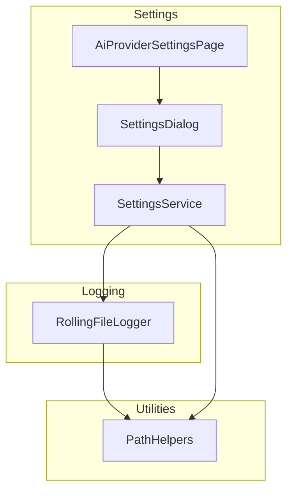

# CanvasPilot

## Architecture

CanvasPilot is a desktop application built on .NET and Avalonia. It is structured as one system. The
software items documented so far are three subsystems, `Logging`, `Settings`, and `Utilities`; further
subsystems (application shell, projects, speech, and image preview) are added to this document as they
are introduced.

`PathHelpers` provides safe path combination and has no dependencies on other local items.
`RollingFileLogger` is the application's only log writer. It uses `PathHelpers` to resolve the active
log file and archive file paths inside its log folder, so that a malformed file name can never place a
log file outside that folder.

`SettingsService` owns the persisted settings and is the only item that reads or writes the settings file.
`SettingsDialog` hosts settings pages through a page contract and saves them through the service;
`AiProviderSettingsPage` is the page for the AI provider choices and implements that contract. The dialog
receives its pages from the application, so the `Settings` subsystem does not depend on the subsystems that
contribute pages. The AI provider choices are stored only; no agent or provider client is part of the
current build, and one added later reads the stored choices through the service.

## External Interfaces

**Log Files**: Local diagnostic output written by the application.

- *Direction*: Output.
- *Type*: Text files on the local file system.
- *Format*: One timestamped, leveled entry per line (exception details follow on additional lines),
  UTF-8, in `canvaspilot.log` plus timestamped archive files in the log folder.
- *Constraints*: The default location is `%LOCALAPPDATA%\CanvasPilot\logs`. Files are written locally
  only; no telemetry or remote transmission is performed. Disk usage is bounded by the rotation size
  and the retained archive count.

**Settings File**: The user's persisted settings.

- *Direction*: Input and output.
- *Type*: JSON file on the local file system.
- *Format*: One UTF-8 `settings.json` document with a `version`, the recent projects, the AI provider
  choices, and the speech choices. Unknown properties are ignored.
- *Constraints*: The default location is `%APPDATA%\CanvasPilot\settings.json`. The file is written
  atomically. A corrupt file is renamed `settings.json.bad` and defaults are used. The file never
  contains credentials.

**Settings Dialog**: The window in which the user edits settings.

- *Direction*: Input and output.
- *Type*: Avalonia modal window.
- *Format*: A page list with OK, Cancel, and Apply buttons.
- *Constraints*: Changes take effect only on OK or Apply, and invalid entries cannot be applied.

## Dependencies

The `Logging`, `Settings`, and `Utilities` subsystems use .NET base class library types, `System.Text.Json`
for the settings file, and, for the dialog and pages, Avalonia and CommunityToolkit.Mvvm, which are
runtime third-party items. Third-party items consumed at run time are documented with the subsystems that
use them as those subsystems are added. Build, documentation, and quality tools are documented in the OTS
design documents (see *OTS Dependencies*).

## Risk Control Measures

**Path confinement**: Every file path built from a caller-supplied name passes through
`PathHelpers.SafePathCombine`, which rejects traversal sequences and absolute paths. `RollingFileLogger`
applies this to its configurable base file name, so logging cannot create or overwrite files outside the
log folder. `SettingsService` applies it to the settings and temporary file names. Segregation of the
checking logic into the `Utilities` subsystem lets it be reviewed and verified once for every consumer.

**Bounded diagnostics**: Log rotation caps the disk space consumed by diagnostic output, so a failure
that logs repeatedly cannot exhaust the user's disk.

**Safe settings handling**: A save writes a temporary file and then replaces the settings file, so a failure
cannot leave a truncated file. A corrupt or newer file is tolerated with defaults and a log entry, so a
damaged file cannot prevent startup. Values are validated when read and when entered, so an out-of-range
value cannot reach the rest of the application.

**Safe agent defaults**: The opt-in for unrestricted agent tools is stored as off by default and changes
only when the user explicitly checks it in the dialog.

## Data Flow

Application subsystems call `RollingFileLogger.Log` with a severity, a message, and optional exception
context. `RollingFileLogger` asks `PathHelpers` to resolve the active file path inside the log folder,
rotates and prunes archives when the active file has reached its size threshold, and appends the
formatted entry to the active file. Nothing flows back to the caller except a propagated `IOException`
when an entry cannot be written.

At startup the application loads the settings through `SettingsService`, which reads and normalizes
`settings.json`. To change settings, the application shows `SettingsDialog` with the pages to host. Each
page loads its working state from the settings in effect; on OK or Apply the dialog merges every page into the
latest settings and calls `SettingsService.Save`, which writes the file atomically and raises `Changed`.

## Design Constraints

- Log files shall be written only to local disk; no telemetry or remote transmission is performed.
- The default log folder shall be under the per-user local application data folder so that no
  administrator rights are required to write logs.
- All file paths built from caller-supplied names shall be resolved with `PathHelpers.SafePathCombine`.
- Logging shall be safe to call from multiple threads.
- The settings file shall be under the per-user application data folder, written atomically, and tolerant
  of missing, corrupt, and newer content.
- Settings pages shall be supplied to the settings dialog, never referenced by it.
- The settings subsystem shall hold no reference to any AI provider SDK or client.
