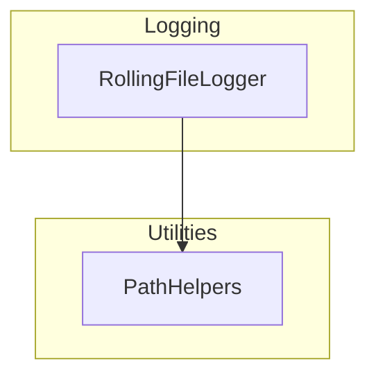

# CanvasPilot

## Architecture

CanvasPilot is a desktop application built on .NET and Avalonia. It is structured as one system. The
software items documented so far are two subsystems, `Logging` and `Utilities`; further subsystems
(application shell, projects, settings, speech, and image preview) are added to this document as they
are introduced.

`PathHelpers` provides safe path combination and has no dependencies on other local items.
`RollingFileLogger` is the application's only log writer. It uses `PathHelpers` to resolve the active
log file and archive file paths inside its log folder, so that a malformed file name can never place a
log file outside that folder.

## External Interfaces

**Log Files**: Local diagnostic output written by the application.

- *Direction*: Output.
- *Type*: Text files on the local file system.
- *Format*: One timestamped, leveled entry per line (exception details follow on additional lines),
  UTF-8, in `canvaspilot.log` plus timestamped archive files in the log folder.
- *Constraints*: The default location is `%LOCALAPPDATA%\CanvasPilot\logs`. Files are written locally
  only; no telemetry or remote transmission is performed. Disk usage is bounded by the rotation size
  and the retained archive count.

## Dependencies

The `Logging` and `Utilities` subsystems use only .NET base class library types. Third-party items
consumed at run time are documented with the subsystems that use them as those subsystems are added.
Build, documentation, and quality tools are documented in the OTS design documents (see *OTS
Dependencies*).

## Risk Control Measures

**Path confinement**: Every file path built from a caller-supplied name passes through
`PathHelpers.SafePathCombine`, which rejects traversal sequences and absolute paths. `RollingFileLogger`
applies this to its configurable base file name, so logging cannot create or overwrite files outside the
log folder. Segregation of the checking logic into the `Utilities` subsystem lets it be reviewed and
verified once for every consumer.

**Bounded diagnostics**: Log rotation caps the disk space consumed by diagnostic output, so a failure
that logs repeatedly cannot exhaust the user's disk.

## Data Flow

Application subsystems call `RollingFileLogger.Log` with a severity, a message, and optional exception
context. `RollingFileLogger` asks `PathHelpers` to resolve the active file path inside the log folder,
rotates and prunes archives when the active file has reached its size threshold, and appends the
formatted entry to the active file. Nothing flows back to the caller except a propagated `IOException`
when an entry cannot be written.

## Design Constraints

- Log files shall be written only to local disk; no telemetry or remote transmission is performed.
- The default log folder shall be under the per-user local application data folder so that no
  administrator rights are required to write logs.
- All file paths built from caller-supplied names shall be resolved with `PathHelpers.SafePathCombine`.
- Logging shall be safe to call from multiple threads.
